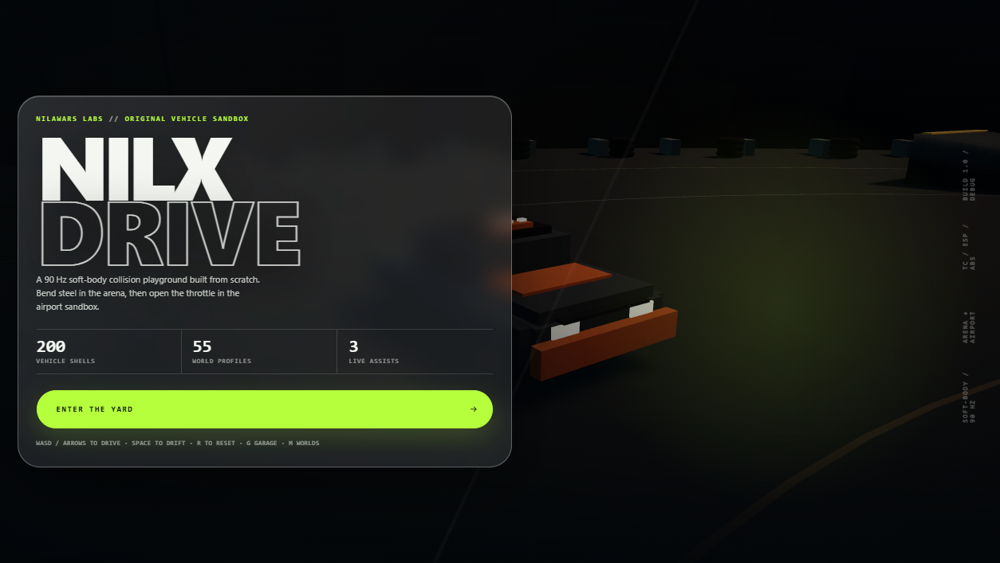
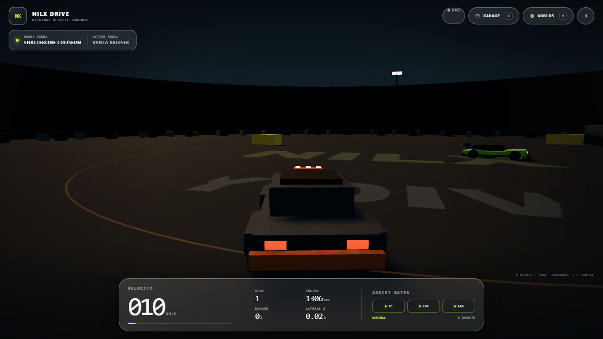
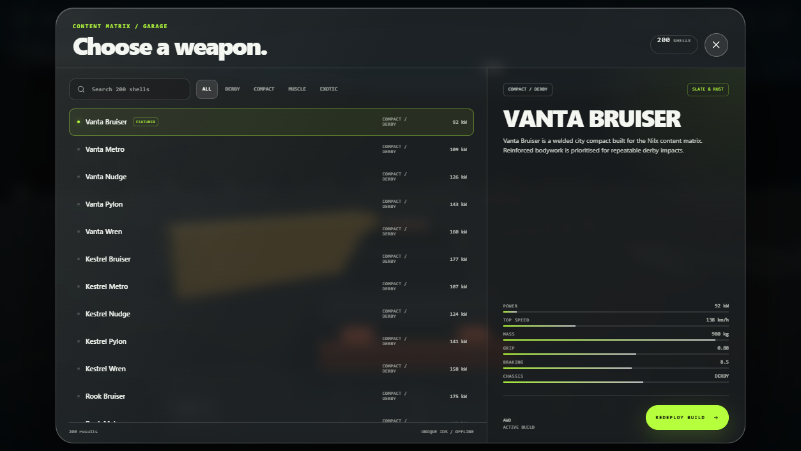
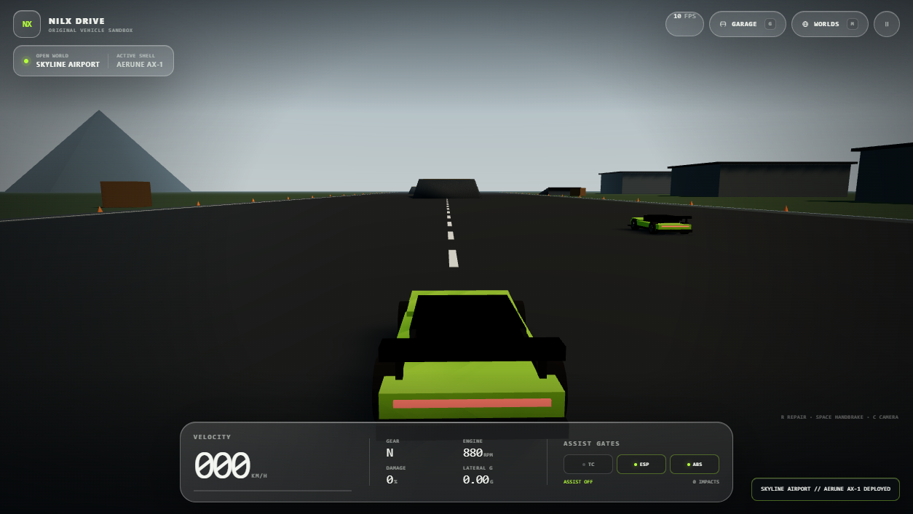

# Nilx Drive

An original Android vehicle-sandbox vertical slice. The game runs fully offline in a native `WebView`, with an HTML5/WebGL renderer built on Three.js, deformable vehicles, arcade physics, and a glassmorphism UI.

No commercial vehicle models, brands, tracks, or other copyrighted assets are used.



## Included in this slice

- **200 original vehicle shells** — 50 Compact, 50 Muscle, 100 Exotic
- **55 world profiles** — 50 arenas and 5 open zones
- **2 playable worlds** — Shatterline Coliseum and Skyline Airport
- **Two procedural chassis** — heavy derby and exotic sport
- **Permanent deformation** from OBB car-to-car, obstacle, and boundary impacts
- **Functional driver aids** — TC, ESP, and ABS toggles with live intervention states
- **Live telemetry** — speed, gear, RPM, damage, lateral G, impact count, FPS
- **Content browsers** — searchable garage and filterable world roster
- **Touch and keyboard controls**, pause/resume, Android back handling
- **In-app update notices** — checks GitHub Releases on launch and shows a glass popup when a newer build is published
- **Fully offline packaging** — vendored Three.js, no CDN or remote assets

| Gameplay | Garage |
| --- | --- |
|  |  |

| Skyline Airport |
| --- |
|  |

## Download

Grab the latest debug APK from [GitHub Releases](https://github.com/nilawarvaibhav16-ai/nilx-drive/releases/latest).

The update button inside the game opens the matching release page in your browser. The app never downloads or installs an APK by itself.

## Requirements

- JDK 17
- Android SDK Platform 35
- Android Build Tools 36.0.0
- The included Gradle wrapper (Gradle 9.3.1)

## Build

```bash
./gradlew assembleDebug
```

On Windows:

```powershell
.\gradlew.bat assembleDebug
```

The debug APK is written to:

```
app/build/outputs/apk/debug/app-debug.apk
```

Install it on a connected device with:

```bash
adb install -r app/build/outputs/apk/debug/app-debug.apk
```

## Controls

### Keyboard

| Input | Action |
| --- | --- |
| `W` / `↑` | Throttle |
| `S` / `↓` | Brake / reverse |
| `A` / `←` | Steer left |
| `D` / `→` | Steer right |
| `Space` | Handbrake |
| `C` | Toggle chase camera |
| `G` | Open garage |
| `M` | Open worlds |
| `P` / `Esc` | Pause / resume |
| `R` | Restart run |

Touch controls appear automatically on compact screens.

## Project structure

```
app/src/main/java/com/nilawarlabs/nilxdrive/
  MainActivity.java          Native WebView host + asset loader
app/src/main/assets/www/
  index.html                 UI shell
  ui.css                     Glassmorphism interface
  main.js                    Boot, validation, Android hooks
  data-shells.json           Generated 200-vehicle / 55-world matrix
  js/
    game.js                  Renderer, fixed-step loop, camera, rival AI
    car.js                   Vehicle physics, assists, damage
    collision.js             OBB2 SAT + permanent deformation
    models.js                Procedural derby/sport chassis
    world.js                 Arena and airport scene builders
    particles.js             Impact/landing effects
    input.js                 Keyboard + touch input
    prefs.js                 Local persistence
    ui.js                    Roster/world browsers and HUD
    util.js                  Shared helpers
  vendor/three.module.js     Vendored Three.js 0.160.1
tools/
  generate-content.mjs       Content-matrix generator
  make-icons.ps1             Launcher icon generator
  test-runtime.mjs           Headless Edge runtime test
  test-device.mjs            ADB WebView device test
```

## Tests

Desktop runtime test:

```bash
node tools/test-runtime.mjs
```

Mobile-viewport runtime test:

```powershell
$env:NILX_MOBILE='1'; node tools/test-runtime.mjs
```

Native WebView test over ADB (requires the WebView DevTools socket forwarded on port `9222`):

```bash
node tools/test-device.mjs
```

The runtime tests cover content counts, start flow, driving, steering, TC toggling, collision deformation, vehicle/world deployment, pause, and Android back/resume.

## Android configuration

- Package: `com.nilawarlabs.nilxdrive`
- minSdk 24
- targetSdk 34
- compileSdk 35
- Landscape-locked
- Cleartext traffic disabled
- Local assets served through `WebViewAssetLoader` on a virtual HTTPS origin

## License and assets

The application code and procedural content in this repository are original work. Three.js is vendored under the MIT license; see `app/src/main/assets/www/vendor/THREE-LICENSE.txt`.
